# 考試生命週期 —— 兩端行為規格

**適用範圍**：`ntut-exam-v2/host`（後端 + 管理端）與 `ntut-exam-v2/desktop`（Electron 學生端）

**建立日期**：2026-09-04　**狀態**：草案 — 待審定

**相關文件**
- `specs/007-exam-lifecycle-state-machine/spec.md` —— 需求規格（User Stories / FR / SC）
- `specs/007-exam-lifecycle-state-machine/design.md` —— 技術設計（schema、API、差異清單）
- 本檔 —— **兩端在每個階段各自做什麼、以及退回、加密、斷線的完整流程說明**

> 本檔放在 `host` repo 根目錄，因為工作區根目錄 `ntut-exam-v2/` 不是 git repo。

---

## 目錄

1. [全域階段總覽](#1-全域階段總覽)
2. [每個階段兩端做什麼](#2-每個階段兩端做什麼)
3. [正常流程時序](#3-正常流程時序)
4. [裝置側流程](#4-裝置側流程)
5. [測資的加密與下發](#5-測資的加密與下發)
6. [退回機制](#6-退回機制)
7. [斷線與離線](#7-斷線與離線)
8. [階段權限矩陣（總表）](#8-階段權限矩陣總表)

---

## 1. 全域階段總覽

全域階段由後端持有，是全系統唯一的進度來源。**單向推進、不可跳階、不可回退**，唯一的例外是全域 reset。

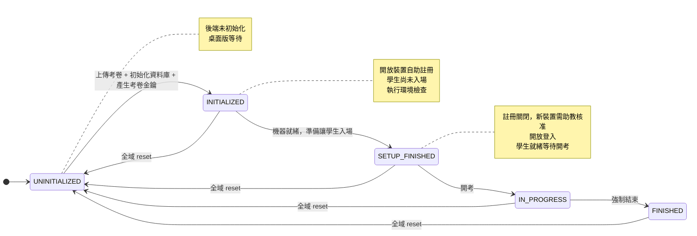

**與現況的對照**

| 本規格 | 現況 | 說明 |
|---|---|---|
| `UNINITIALIZED` | `UNINITIALIZED` | 不變 |
| `INITIALIZED` | `NOT_STARTED` 的前半 | **改名**。現況名稱字面上像「還沒開始」，實際上是「已初始化」 |
| `SETUP_FINISHED` | 無 | **新增**。現況把它與 `INITIALIZED` 混為一談，導致註冊要到開考才關閉 |
| `IN_PROGRESS` | `IN_PROGRESS` | 不變 |
| `FINISHED` | `FINISHED` | 不變 |

**Ready 不是一個階段。** 它是 `SETUP_FINISHED` 階段中，單一學生的推導狀態 —— 見 §4.3。

---

## 2. 每個階段兩端做什麼

### 2.1 `UNINITIALIZED`

| | 後端 | 桌面版 |
|---|---|---|
| **做什麼** | 接受管理員上傳與驗證考卷；拒絕所有學生端請求 | 停在等待畫面，週期性詢問後端階段 |
| **不做什麼** | 不接受註冊、登入、考卷索取、提交 | 不註冊、不登入、不檢查環境 |
| **畫面** | 管理端顯示「尚未初始化」與上傳入口 | `/not-initialized` |

**推進到下一階段的前置條件**（四項全部成立才允許）：

1. 考卷已上傳並通過驗證
2. 資料庫已依名單建立學生與成績單
3. 考卷金鑰 `K_exam` 已產生
4. 考卷已切分為公開部分與密文，且口令包裝的金鑰已產生

---

### 2.2 `INITIALIZED` —— 機器進場，學生未進場

這個階段的存在理由：**讓機器在無人的教室裡把該做的事做完**。

| | 後端 | 桌面版 |
|---|---|---|
| **做什麼** | 開放裝置自助註冊；對已註冊裝置下發考卷公開部分與密文 | 自動註冊 → 背景取得語言清單並檢查；考卷另行取得 → 待命 |
| **不做什麼** | **不接受登入**；**不下發考卷金鑰** | **不提供登入入口** |
| **畫面** | 管理端顯示已註冊機器數、環境檢查通過數 | 待命畫面，顯示註冊與環境檢查進度 |

**環境檢查在此階段開始。** 桌面版註冊成功後，以裝置 AES 封包呼叫 `POST /user/exam/languages`；只需語言清單，使用既有固定診斷限制，不等待完整考卷或學生登入。檢查與取得失敗都只提供警示，不阻擋登入或合法階段切換。檢查項目沿用既有的合成探針：

| 探針 | 驗證什麼 |
|---|---|
| 工具版本 | 編譯器／直譯器存在且可執行 |
| smoke | 編譯 → 執行 → 輸出比對，整條路走得通 |
| tle | 逾時偵測確實會觸發 |
| mle | 記憶體限制確實會觸發 |

---

### 2.3 `SETUP_FINISHED` —— 學生進場、登入、等待

| | 後端 | 桌面版 |
|---|---|---|
| **做什麼** | **關閉自助註冊**；新註冊一律轉為助教待審並拒絕；開放登入；記錄每位學生的就緒狀態 | 顯示登入畫面 → 嘗試以來源位置自動登入 → 失敗則手動輸入學號 → 登入後進入等待畫面 |
| **不做什麼** | **不下發考卷金鑰**；不接受提交 | **不可進入設定頁**（避免學生自行變更連線或載入考卷） |
| **畫面** | 管理端「學生準備狀況」頁 | 登入畫面 / 等待畫面 |

**這是註冊閘門關閉的時刻。** 現況要到開考才關閉，等於整個入場與等待期間都能自由註冊新裝置 —— 而學生正是在那段時間進場的。

---

### 2.4 `IN_PROGRESS` —— 考試中

| | 後端 | 桌面版 |
|---|---|---|
| **做什麼** | **釋出考卷金鑰**；接受提交作答與分數；持續同步 | 取得金鑰 → 解密考卷 → 進入考試畫面；本機評測；提交 |
| **仍然關閉** | 自助註冊（重來仍需助教核准） | — |
| **仍然開放** | 登入（重來路徑必須能重新登入） | — |

---

### 2.5 `FINISHED` —— 結束

| | 後端 | 桌面版 |
|---|---|---|
| **做什麼** | 收卷緩衝期內仍接受提交；緩衝結束後拒絕 | 緩衝期內可完成最後上傳，之後進入結束畫面 |
| **不做什麼** | 不再下發考卷、不再下發金鑰、不接受登入 | — |

---

## 3. 正常流程時序

從佈署到開考的完整互動。`監考` 與 `管理員` 在小型考場可能是同一人，此處分開標示以說明職責。

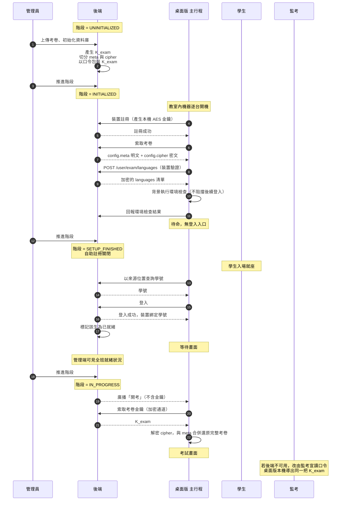

**關鍵設計點**：開考的廣播**不含金鑰**。socket 廣播對所有連線者發送、不驗證接收者，因此只傳遞「開考」這個事實；金鑰一律走後續的點對點加密通道（`索取考卷金鑰` → `K_exam`），且後端只在階段為 `IN_PROGRESS` 時才回應。

---

## 4. 裝置側流程

### 4.1 桌面版啟動後的決策

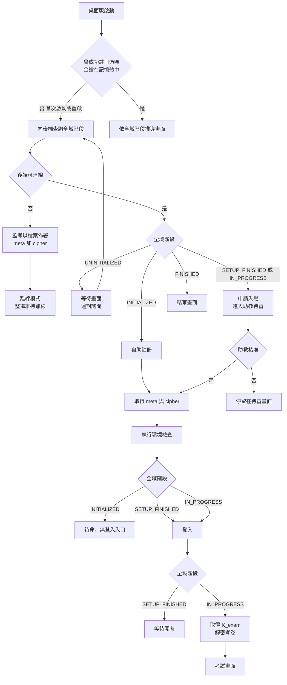

**注意 J 這一格**：`SETUP_FINISHED` 之後啟動的機器（無論是新機器還是重啟的機器）走的是同一條路 —— 申請入場、等待助教核准。**沒有第二套流程。**

### 4.2 學生端狀態是推導值，不是狀態機

桌面版**不維護**自己的考試階段。畫面由兩個輸入推導：

```
畫面 = f(全域階段, 本機裝置狀態)

本機裝置狀態 ∈ { 未註冊, 已註冊未登入, 已登入 }
```

| 全域階段 | 未註冊 | 已註冊未登入 | 已登入 |
|---|---|---|---|
| `UNINITIALIZED` | 等待畫面 | 等待畫面 | 等待畫面 |
| `INITIALIZED` | 自動註冊 | 環境檢查 → 待命 | *不會出現* |
| `SETUP_FINISHED` | 申請入場 | 登入畫面 | 等待畫面（Ready） |
| `IN_PROGRESS` | 申請入場 | 登入畫面 | 考試畫面 |
| `FINISHED` | 結束畫面 | 結束畫面 | 結束畫面（緩衝期內可續交） |

**推論**：學生端不需要「退回」的概念。清掉本機裝置狀態之後重新推導，自然會落在正確的位置。

**第三個輸入：離線機器**（2026-09-10 補正，見 `specs/007-.../bugfixes.md` BUG-03）

離線機器**永遠**是「未註冊」—— 註冊正是它做不到的事 —— 因此上表會把它送到「申請入場」，而入場核准要靠它沒有的那條連線送達。整條離線路徑因此無法抵達口令開考的入口，而那正是離線路徑存在的理由。

```
畫面 = f(全域階段, 本機裝置狀態, 是否為離線機器)
```

| 全域階段 | 離線機器（未註冊） |
|---|---|
| `SETUP_FINISHED` | 登入畫面（以本機名單手動輸入學號） |
| `IN_PROGRESS` | 登入畫面 |

登入後即為「已登入」，落在等待畫面 —— 監考口令的輸入框就在那裡。離線機器在任何階段都不得被導向「申請入場」。

**訂閱點只有一個**（BUG-01）：全域階段的變更由 `App.vue` 單一訂閱並重新推導。頁面不得各自解讀階段事件 —— 本功能第一版把這條規則寫成七個頁面各自的 `onMounted`，於是它只在其中五個頁面成立，reset 後考試頁原地不動。

### 4.3 Ready 的定義

一位學生「已就緒」是後端可觀察的推導值：

```
Ready = 全域階段為 SETUP_FINISHED
      ∧ 該裝置在線
      ∧ 該裝置已綁定學號
      ∧ 該裝置已回報環境檢查通過
```

管理端的「學生準備狀況」頁即以此呈現。學生登入後仍保留裝置的 FAILED 警示；修復並重試通過後才更新為 PASSED。未綁學生的裝置結果不以 IP 猜配。

---

## 5. 測資的加密與下發

### 5.1 兩層加密的職責

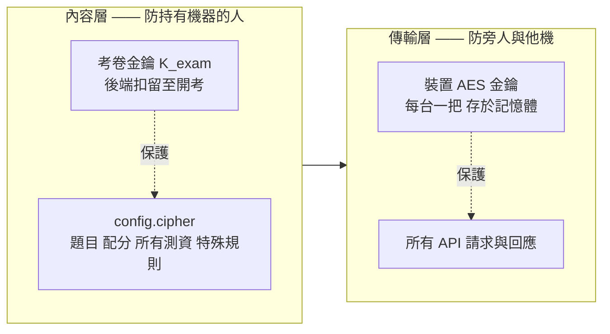

**為什麼需要兩層**：裝置 AES 金鑰位於學生機器的記憶體，學生本就持有它。用它加密考卷，對那台機器上的人而言等於沒有加密 —— 這正是現況的問題。內容層必須是一把**後端扣留到開考才釋出**的獨立金鑰。

### 5.2 考卷的切分

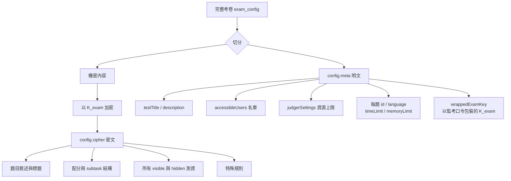

**切分原則**：只有環境檢查與入場流程真正需要的資料才進 meta。題目標題會透露主題，因此也放進密文。

**還原**：桌面版取得 `K_exam` 後解密，依題目 id 與 meta 合併，還原成與現行結構等價的完整考卷。**評測、畫面、特殊規則等下游程式碼完全不需改動** —— 若下游需要改，代表切分位置錯了。

### 5.3 金鑰的兩條取得路徑

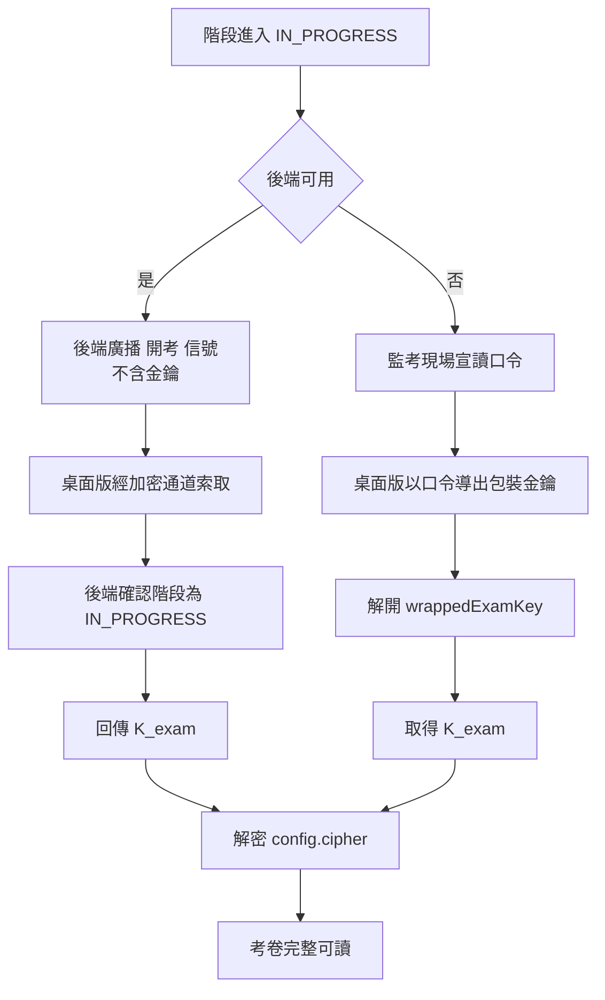

**三個必須成立的性質**：

1. **兩條路徑導出同一把金鑰。** 因此不存在「哪個是權威」的問題 —— 權威是金鑰本身。哪條先到就用哪條，重複取得無副作用。
2. **路徑 B 是常備路徑，不是緊急開關。** 它必須隨時可用而不需任何模式切換 —— 因為需要它的時刻，正是後端不可用、無法進行任何切換的時刻。
3. **口令不下發。** 現況 `startPassword` 明文隨考卷送到每台學生機器再於前端比對 —— 等於把閘門的鑰匙發給被擋的人。改制後後端保留明文用於產生 `wrappedExamKey`，學生機器只收到包裝後的結果。

### 5.4 測資在學生機器上的可讀時間軸

```
UNINITIALIZED    ─────────────────────────────  機器上無任何考卷資料
INITIALIZED      ─── meta 明文 ── cipher 密文 ──  測資不可讀
SETUP_FINISHED   ─── meta 明文 ── cipher 密文 ──  測資不可讀（學生已就座）
IN_PROGRESS      ─── meta 明文 ── 已解密     ──  測資可讀
FINISHED         ─── meta 明文 ── 已解密     ──  測資可讀
```

對照現況：**登入成功的當下即完整可讀**，而登入發生在 `SETUP_FINISHED`。

---

## 6. 退回機制

系統有兩種退回，語意完全不同，**必須可被區分**。

| | 全域 reset | 單一學生重來 |
|---|---|---|
| **影響範圍** | 全系統 | 單一裝置 |
| **全域階段** | 回到 `UNINITIALIZED` | **不變** |
| **其他學生** | 全部受影響 | 不受影響 |
| **考試資料** | 全部清空 | **保留** |
| **觸發者** | 管理員 | 助教，或機器重啟時自然發生 |

### 6.1 全域 reset

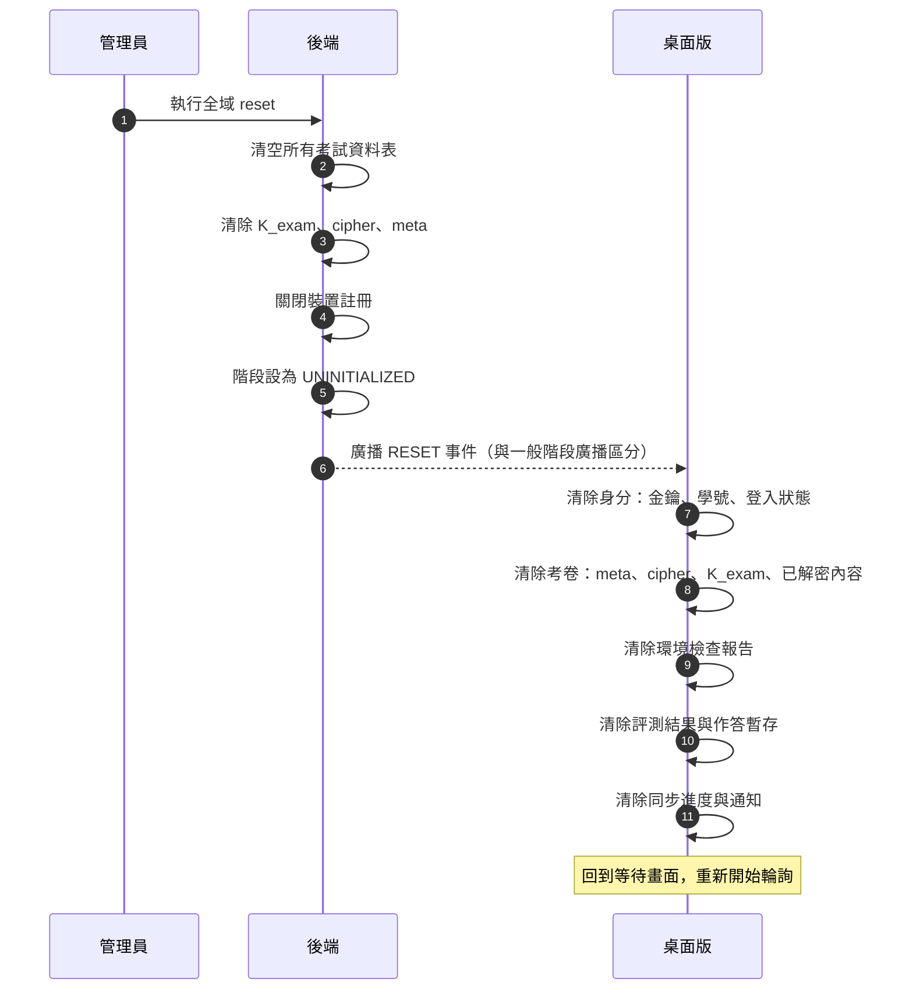

**為什麼廣播必須與一般階段轉移區分**：兩者在客戶端的處理完全不同。現況兩者共用同一條路徑，桌面版收到後只更新階段字串、其餘一律不動 —— 結果是後端資料已清空，桌面版仍持有失效的金鑰，之後所有加密請求回 401，且沒有自動重新註冊的路徑。**這是 reset 目前在實務上不可用的根因。**

**桌面版必須清除的完整清單**：

| 項目 | 現況 |
|---|---|
| 全域階段 | ✅ 已清 |
| 登入狀態、學號 | ❌ 未清 |
| 裝置 AES 金鑰與 session token | ❌ 未清 |
| 已解密的考卷 | ❌ 未清 |
| meta、cipher、`K_exam` | 新增項目 |
| 環境檢查報告 | ❌ 未清 |
| 評測結果（一般／最高分／特殊規則） | ❌ 未清 |
| 本機作答暫存目錄 | ❌ 未清 |
| 訊息版本、考卷版本、通知 | ❌ 未清 |
| 離線模式旗標、待回填登入旗標 | ❌ 未清 |

### 6.2 單一學生重來

**核心觀念**：不做階段退回，而是**清除裝置身分後重走一次完整流程**。

清除的邊界剛好對應資料的索引鍵：

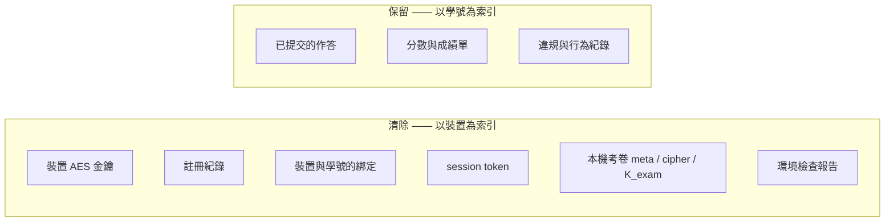

**兩種觸發方式，行為完全相同**：

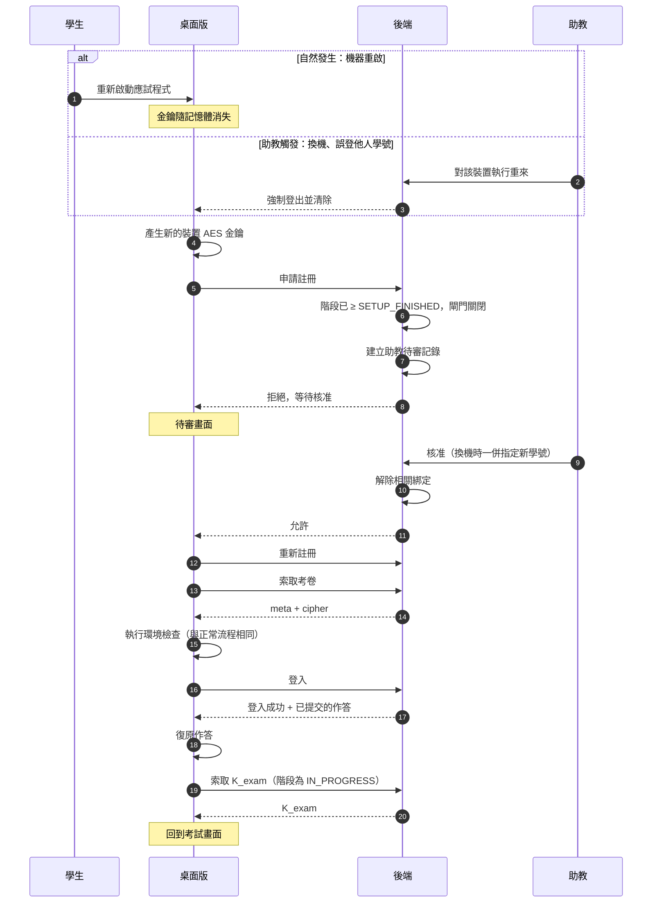

**三個必須成立的性質**：

1. **重來不繞過任何閘門。** 它是重新從閘門進來，因此助教核准仍是必經之路，安全模型不變。
2. **不維護第二條工序。** 重來後的流程與一般入場**逐步相同**，包含環境檢查。不做任何簡化或特例。
3. **成果層完全不受影響。** 重來前後，該生的分數與已提交的作答完全相同。

**已接受的限制**：尚未提交的本機作答會遺失（本機檔案存於每次啟動重建的暫存目錄）。後端具備作答的自動下載與恢復功能並有一定程度的備份，故此限制已被接受。

### 6.3 助教核准的三種情境

註冊被閘門擋下時，助教需要能區分：

| 情境 | 判別條件 | 助教的處置 |
|---|---|---|
| **A. 已綁學生的機器重新入場** | 裝置存在且已綁定學號 | 允許原學號登入 ／ 允許改綁新學號 |
| **B. 全新機器** | 裝置不存在 | 允許 ／ 拒絕 |
| **C. 已註冊但未綁學生的機器** | 裝置存在但未綁定 | 允許 ／ 拒絕 |

現況只有兩種分類，A 與 C 會混在一起。且待審清單只有五個欄位，助教無從判斷 —— 需補上原綁學號、該學號是否在他機上線、上次斷線時間、來源位置是否與名單相符。

**換機必須一次解完兩邊。** 現況只解除「這台機器原本綁的人」，若新學號自己還綁在另一台機器上，登入時仍會被擋，需要跑第二次流程。核准介面必須讓助教直接指定「這台機器接下來給哪個學號」。

**被拒絕的申請不得有副作用。** 現況在拒絕之前就先寫入裝置狀態，使得任何人送一個帶他人裝置識別的申請，就能把一位正在考試的學生在助教畫面上降級並灌入待審佇列 —— 而裝置識別在每個請求中都是明文，不是秘密。

---

## 7. 斷線與離線

### 7.1 模式由「是否曾成功註冊」決定

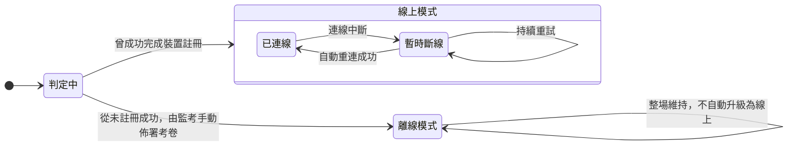

這與現況不同：現況的模式由**考卷的取得來源**決定（手動上傳檔案就永久離線），而不是由註冊是否成功決定。

### 7.2 三種斷線情境

| 情境 | 系統行為 |
|---|---|
| **考試中短暫斷線** | 不改變模式。作答、評測、計分全部照常；階段同步、訊息、分數上傳暫停；自動重連，恢復後補送 |
| **開考瞬間後端不可用** | 走金鑰路徑 B（監考宣讀口令），全班照常開考 |
| **從未連上後端** | 整場離線。監考以 `{meta, cipher}` 檔案佈署，口令開考 |

### 7.3 斷線期間與恢復後

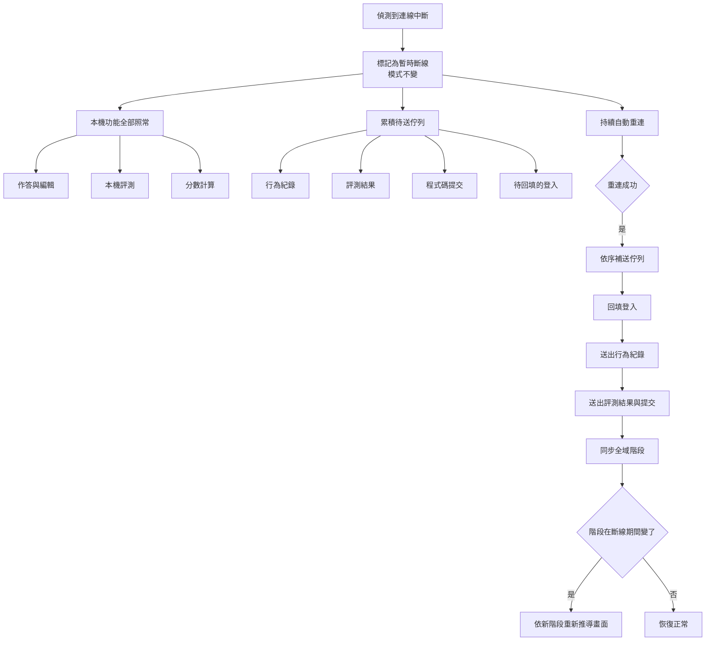

**需修正的既有缺陷**：現況待送佇列中，行為紀錄與回填登入是真的有實作的，但**評測結果與程式碼提交的重送是空的** —— 恢復連線時只是把旗標清掉，寄望學生下次評測時順帶重送。若學生不再重跑，斷線期間的結果就永久遺失。

### 7.4 學生不得自行進入離線模式

現況桌面版設定頁在路由中無條件放行，考試中已登入的學生仍可進入；該頁提供考卷檔案上傳，而上傳會將機器永久切換為離線模式並停止所有同步。**結果是學生可以用兩次點擊把自己從所有伺服器控制中移除**（不再收強制登出、不再收階段廣播、不再回報違規），而助教端只會看到「掉線」，與真實網路故障無從區分。

**規定**：進入 `SETUP_FINISHED` 之後，設定頁一律不可進入；離線佈署只能在該階段之前、由監考在該台機器上執行。

### 7.5 後端不可用時的降級程序

| 發生時機 | 結果 |
|---|---|
| `INITIALIZED` 之前 | 機器尚未取得考卷，由監考以 `{meta, cipher}` 檔案手動佈署。**佈署檔採用與線上下發相同的保護形式**，因此隨身碟遺失也不會洩漏測資 |
| `IN_PROGRESS` 期間，已開考的機器 | **完全不受影響**。考卷已解密於記憶體，評測在本機執行 |
| `IN_PROGRESS` 期間，重啟的機器 | **無法救回**。考卷密文與金鑰皆在記憶體，兩者都須向後端重新取得；口令只能解密文，無法生出密文 |
| 考試結束 | **由監考口頭宣布、逐台收卷**。已決策不做本機倒數與斷線自動鎖卷 |

**已接受的後果**：後端不可用期間，學生端在系統層面沒有結束訊號，作答狀態會持續到監考逐台確認為止。

---

## 8. 階段權限矩陣（總表）

實作時，這張表應該落在**單一處**（一個中介層），而不是散落在各個服務裡。現況這些規則散在桌面版路由守衛、裝置服務、認證服務、壓測服務四個地方，而且全後端只有壓測服務真正檢查階段。

| 操作 | `UNINITIALIZED` | `INITIALIZED` | `SETUP_FINISHED` | `IN_PROGRESS` | `FINISHED` |
|---|:---:|:---:|:---:|:---:|:---:|
| 裝置自助註冊 | ✗ | **✓** | ✗ ※ | ✗ ※ | ✗ |
| 學生登入 | ✗ | ✗ | **✓** | **✓** | ✗ |
| 下發 `config.meta` | ✗ | **✓** | ✓ | ✓ | ✗ |
| 下發 `config.cipher` | ✗ | **✓** | ✓ | ✓ | ✗ |
| 下發 `K_exam` | ✗ | ✗ | ✗ | **✓** | ✗ |
| 提交程式碼 | ✗ | ✗ | ✗ | **✓** | △ |
| 提交分數 | ✗ | ✗ | ✗ | **✓** | △ |
| 進入桌面版設定頁 | ✓ | ✓ | ✗ | ✗ | ✗ |
| 環境檢查 | ✗ | **✓** | ✓ | ✓ | — |

※ 轉為助教待審後拒絕本次申請　　△ 收卷緩衝期內允許，之後拒絕

---

## 附錄：與現況的關鍵差異

| # | 項目 | 現況 | 本規格 |
|---|---|---|---|
| 1 | 階段數 | 4 個，`NOT_STARTED` 身兼二職 | 5 個，語意各自獨立 |
| 2 | 階段轉移 | 任意兩狀態可跳 | 單向查表，僅 reset 可退 |
| 3 | 註冊關閉時機 | 進入考試中才關 | 進入設定完成即關 |
| 4 | 註冊觸發 | 由登入流程懶觸發 | `INITIALIZED` 的獨立步驟 |
| 5 | 考卷下發 | 登入成功即下發完整明文 | meta 早發、密文早發、金鑰開考才發 |
| 6 | 開考口令 | 明文下發、前端比對 | 不下發，升格為金鑰的包裝 |
| 7 | 開考權威 | 後端廣播與口令兩套並存且語意不明 | 同一把金鑰的兩條取得路徑 |
| 8 | reset 客戶端行為 | 僅更新階段字串 | 完整清除（§6.1 清單） |
| 9 | 重啟後重新登入 | 一律判為二次綁定，死路 | 走重來路徑，核准後回到考試 |
| 10 | 助教核准資訊 | 五個欄位，無法區分三情境 | 補齊判斷資訊與情境分類 |
| 11 | 被拒申請的副作用 | 先寫入狀態再拒絕 | 無副作用 |
| 12 | 環境檢查結果 | 只存在桌面版記憶體 | 上報後端，構成準備狀況頁 |
| 13 | 階段權限檢查 | 僅壓測服務有 | 集中矩陣，全面檢查 |
| 14 | 桌面版設定頁 | 考試中仍可進入並自行離線 | `SETUP_FINISHED` 後鎖定 |
| 15 | 離線模式判定 | 由考卷來源決定且不可逆 | 由註冊是否成功決定 |
| 16 | 離線佈署檔 | 明文完整考卷 | `{meta, cipher}`，口令解密 |
| 17 | 斷線重送 | 評測結果與提交為空實作 | 真正的重送佇列 |
| 18 | 收卷緩衝 | 僅前端常數，後端不檢查 | 後端執行，單一設定來源 |

## 考前語言檢查增量（2026-10-15）

語言清單成功取得後保存在本次入場的記憶體快照。普通登入、重連、config_update 與手動重試都不刷新成功快照；考前改語言後須重啟桌面版，並依既有階段規則重新註冊／助教核准。完全離線檔案仍依 meta 檢查，不呼叫此 API。

回報只包含狀態、失敗語言與 sequence；後端以註冊金鑰和序號原子更新，避免 timeout 後的舊 RUNNING 蓋掉 PASSED。reset 及更換後端／金鑰會取消本機檢查並清除快照、待送報告。此增量需要兩端同時部署；舊桌面版環境回報缺 sequence 將回 400。資料庫啟動時自動補 env_check_sequence 欄位，不移除現有作答。驗證證據與未完成門檻見 specs/007-exam-lifecycle-state-machine/validation.md。


## SETUP_FINISHED 的離線備卷（desktop 配對更新）

已合法註冊的 desktop 在進入 SETUP_FINISHED 時，即以裝置加密請求取得封存考卷，不需先登入學生。晚啟動／人工核准後、成功狀態同步及重連時補抓；每 60 秒亦獨立嘗試備卷，不等待消息同步。INITIALIZED 的既有取卷權限保留，但此次桌面端不新增該階段的自動下載。

`POST /user/exam/config` 驗證裝置加密、timestamp/nonce，交付前重查註冊金鑰及階段。meta/cipher 由單一 SQL upsert 儲存、單一 SELECT 讀取，避免更新交錯形成混合考卷。此端點不授予學生身分、人工核准或開考金鑰；`/user/exam/key` 的既有開考階段與學生認證要求維持。

desktop 登入與等待頁將離線考卷備妥狀態獨立於環境預檢呈現。下載失敗會重試；更新失敗時保留同一場有效考卷與待刷新意圖。完成備卷後，即使輸入學號前斷線，仍能依既有名單及監考口令開考；恢復連線後依原有規則補登入與上傳。

考卷、名單與解封金鑰在 desktop 僅存 RAM，關閉程式即失去；host 沿用資料庫保存。未完成下載前斷網無法只憑口令取得考卷。此行為須配對新版 desktop；只更新 host 不會修正舊桌面端的下載時機。考場實體拔線與重複次數驗收仍須另行完成。
