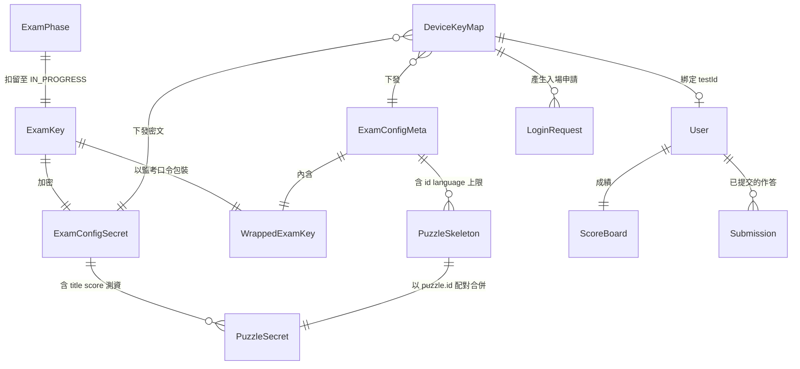

# Phase 1 Data Model: Exam Lifecycle State Machine and Paper Encryption

**Feature**: `007-exam-lifecycle-state-machine`　**Date**: 2026-09-04

本檔定義本功能涉及的實體、欄位、驗證規則與狀態轉移。跨越 `host`（後端）與 `desktop`（學生端）兩個 repo，每個實體標註其所在位置與持久化方式。

---

## 1. 全域考試階段 `ExamPhase`

**位置**：後端 `SystemSettings.exam_state`（持久化）；桌面版 `ramStore.examStatus`（RAM，由廣播與輪詢同步）

**型別**：五值列舉，取代現行的四值。

```
UNINITIALIZED | INITIALIZED | SETUP_FINISHED | IN_PROGRESS | FINISHED
```

**狀態轉移**（唯一合法的轉移集合，其餘一律拒絕）

| From | To | 前置條件 |
|---|---|---|
| `UNINITIALIZED` | `INITIALIZED` | 考卷已上傳並驗證；學生與成績單已建立；`K_exam` 已產生；`config.meta` 與 `config.cipher` 已產生 |
| `INITIALIZED` | `SETUP_FINISHED` | 無額外條件（管理員判斷機器已就緒） |
| `SETUP_FINISHED` | `IN_PROGRESS` | 無額外條件（開考） |
| `IN_PROGRESS` | `FINISHED` | 無額外條件（強制結束） |
| *任一* | `UNINITIALIZED` | 僅限全域 reset 通道，需確認字串 |

**驗證規則**

- 轉移必須逐一比對上表；跳階、回退與原地轉移（`from === to`）一律拒絕。
- 驗證必須在服務層執行，不得僅由管理端 UI 限制。
- reset 不是一次階段轉移，其程式路徑必須與 `changeState` 可區分。

**副作用**

| 進入的階段 | 副作用 |
|---|---|
| `INITIALIZED` | `allow_device_registration = true` |
| `SETUP_FINISHED` | `allow_device_registration = false` |
| `IN_PROGRESS` | 廣播開考事件（**不含金鑰**） |
| `UNINITIALIZED`（經 reset） | 清空所有考試資料；清除 `K_exam` / `cipher` / `meta`；`allow_device_registration = false`；廣播 `exam-reset` |

---

## 2. 考卷金鑰 `ExamKey`

**位置**：後端 `SystemSettings.exam_key`（持久化，列入 `PROTECTED_SETTINGS_KEYS`）；桌面版 `ramStore.examKey`（RAM-only）

| 欄位 | 型別 | 說明 |
|---|---|---|
| 值 | 32 bytes（hex 字串儲存） | AES-256 金鑰，每場考試一把 |

**生命週期**

```
產生：進入 INITIALIZED 之前（初始化流程的一部分）
扣留：INITIALIZED、SETUP_FINISHED 期間，任何請求一律拒絕
釋出：IN_PROGRESS 期間，經加密通道對已註冊裝置回應
清除：全域 reset
```

**驗證規則**

- 必須以密碼學安全的隨機來源產生。
- 不得出現在 `config.meta`、日誌、或任何未加密的回應中。
- 不得經 socket 廣播（廣播不驗證接收者）。
- 考卷更新時**不重新產生**（口令不變，已下發的 `wrappedExamKey` 必須維持有效）。

---

## 3. 考卷公開部分 `ExamConfigMeta`

**位置**：後端 `SystemSettings.exam_config_meta`；桌面版 `ramStore.examConfigMeta`

**明文**。自 `INITIALIZED` 起可下發給已註冊裝置。

| 欄位 | 型別 | 來源 | 用途 |
|---|---|---|---|
| `testTitle` | string | 原考卷 | 顯示 |
| `description` | string | 原考卷 | 顯示 |
| `accessibleUsers[]` | `{ id, name, ip? }` | 原考卷 | 自動登入、離線名單比對 |
| `judgerSettings` | `{ timeLimit, memoryLimit, ... }` | 原考卷 | 環境檢查探針的真實上限 |
| `submitGraceSeconds` | number | **新增設定** | 收卷緩衝期，預設 60（見 research R1）。新增此欄位須同步三份 schema 定義與管理端表單 |
| `sections[]` | `{ id, title, maxScore, puzzles[] }` | 原考卷（裁剪） | 結構骨架 |
| `sections[].puzzles[]` | `{ id, language, timeLimit?, memoryLimit? }` | 原考卷（裁剪） | **僅此四欄** |
| `wrappedExamKey` | `{ salt, iv, ciphertext, tag }` | 新產生 | 離線取得 `K_exam` |

**驗證規則**

- `puzzles[]` **不得**包含 `title`、`score`、`subtasks`、`specialRules`。
- 整份 meta **不得**包含任何 `input` / `output` 測資欄位。
- **不得**包含 `environmentVariables.startPassword` 的明文。
- `sections[].title` 保留（區塊標題不透露個別題目主題）；`puzzles[].title` 移除。

---

## 4. 考卷機密部分 `ExamConfigSecret`

**位置**：後端 `SystemSettings.exam_config_cipher`（密文）；桌面版 `ramStore.examConfigCipher`（密文）

**加密前的形狀**

| 欄位 | 型別 |
|---|---|
| `puzzles[]` | `{ id, title, score, subtasks[], specialRules? }` |
| `puzzles[].subtasks[]` | `{ title, score, visible[], hidden[] }` |
| `globalSpecialRules[]` | 特殊規則陣列 |

**加密後的封包**（與現行 `AesEncryptedPayload` 同形，見 research R6）

```
{ iv: base64, ciphertext: base64, tag: base64 }
```

**驗證規則**

- 以 `K_exam` 經 `AES-256-GCM` 加密，每次加密使用新的 12-byte IV。
- 桌面版在取得 `K_exam` 之前，此欄位必須維持為未解密的封包。
- 解密失敗（含 GCM 認證失敗）必須視為錯誤而非空考卷 —— 認證失敗代表密文遭竄改。

---

## 5. 合併後的完整考卷 `ExamConfig`（既有型別，不變更）

**位置**：桌面版 `ramStore.examConfig`（RAM-only）

**合併規則**

```
examConfig = merge(meta, decrypt(cipher, K_exam))
  以 puzzle.id 為鍵配對
  meta 提供：id, language, timeLimit, memoryLimit, section 歸屬
  secret 提供：title, score, subtasks, specialRules
```

**驗證規則**

- 合併結果**必須**通過既有的 `examConfigSchema`。這是 `spec.md` SC-009（下游 0 處修改）的驗收條件。
- 合併前 `examConfig` 必須為 `null`。下游程式碼以此判斷考卷是否可用，不需額外的階段檢查。
- meta 與 secret 的 `puzzle.id` 集合必須完全相同；不一致視為錯誤。

---

## 6. 考試裝置 `DeviceKeyMap`（既有，擴充）

**位置**：後端資料表（持久化）

| 欄位 | 狀態 | 說明 |
|---|---|---|
| `deviceUuid` | 既有 | 主鍵，硬體識別，**非機密**（每個請求明文攜帶） |
| `clientAesKey` | 既有 | 裝置 AES 金鑰（傳輸層） |
| `testId` | 既有 | 綁定的學號，可為 null |
| `ipAddress` | 既有 | 來源位置 |
| `isOnline` | 既有 | 連線狀態 |
| `socketId` | 既有 | 目前的 socket |
| `status` | 既有 | `UNBOUND` / `AWAITING_LOGIN` / `ONLINE` |
| `envCheckStatus` | **新增** | `UNKNOWN` / `RUNNING` / `PASSED` / `FAILED` |
| `envCheckFailedLanguages` | **新增** | 失敗的語言清單，JSON 陣列，可為空 |
| `envCheckReportedAt` | **新增** | 最近一次上報時間 |
| `lastDisconnectedAt` | **新增** | 供助教判斷斷線多久（見實體 7） |

**驗證規則**

- `envCheckFailedLanguages` 只存語言名稱，**不存診斷輸出**（見 research R9）。
- 被拒絕的入場申請**不得**修改本實體的任何欄位（`spec.md` FR-010）。

**重來時的清除**：整筆記錄刪除（`unregisterDevice`），對應學號的 `Submission` 與 `ScoreBoard` 不受影響。

---

## 7. 入場申請 `LoginRequest`（既有，擴充）

**位置**：後端資料表（持久化）

| 欄位 | 狀態 | 說明 |
|---|---|---|
| `id` | 既有 | 主鍵 |
| `deviceUuid` | 既有 | 申請的裝置 |
| `ipAddress` | 既有 | 來源位置 |
| `testId` | 既有 | 推測的學號（依 IP 或原綁定） |
| `type` | **變更值域** | `NEW_DEVICE` / `REBIND` / `UNBOUND_DEVICE`（見 research R3） |
| `previousTestId` | **新增** | `REBIND` 時該裝置原本綁定的學號 |
| `status` | 既有 | `PENDING` / `ALLOWED` / `REJECTED` |
| `createdAt` | 既有 | 建立時間 |

**助教判斷所需的衍生資訊**（查詢時 join，不落地）

| 資訊 | 來源 |
|---|---|
| 原綁定學生的姓名 | `User` by `previousTestId` |
| 該學號目前是否在他機上線 | `DeviceKeyMap` by `testId`，檢查 `isOnline` |
| 上次斷線時間 | `DeviceKeyMap.lastDisconnectedAt` |
| 來源 IP 是否與名單相符 | 比對 `User.ipAddress` |

**核准操作的參數**

| 參數 | 說明 |
|---|---|
| `targetTestId` | 這台機器接下來要給哪個學號。`REBIND` 改綁時必填 |
| 解綁行為 | 若 `targetTestId` 與 `previousTestId` 不同，**同時**解除：該裝置與 `previousTestId` 的綁定、以及 `targetTestId` 與其原裝置的綁定（`spec.md` FR-012） |

---

## 8. 桌面版本機狀態 `RamStoreState`（既有，擴充）

**位置**：桌面版記憶體，永不落盤

| 欄位 | 狀態 | reset 時 | 重來時 |
|---|---|---|---|
| `examStatus` | 既有（值域變更） | 清 | 保留（全域階段不變） |
| `cryptoState` | 既有 | **清** | **清** |
| `studentInfo` / `isStudentVerified` | 既有 | **清** | **清** |
| `examConfigMeta` | **新增** | **清** | **清** |
| `examConfigCipher` | **新增** | **清** | **清** |
| `examKey` | **新增** | **清** | **清** |
| `examConfig` | 既有 | **清** | **清** |
| `environmentCheckReport` | 既有 | **清** | **清** |
| `testResults` 等評測結果 | 既有 | **清** | **清** |
| `notifications` / `messageVersion` / `configVersion` | 既有 | **清** | 清 |
| `isOfflineMode` | 既有（語意變更） | **清** | 保留 |
| `pendingLoginSync` | 既有 | **清** | 清 |
| `connectionStatus` / `socketStatus` | 既有 | 保留 | 保留 |

> 標示 **清** 的項目中，現況只有 `examStatus` 會在 reset 時被更新，其餘一律未清 —— 這是 reset 目前在實務上不可用的根因。

**`isOfflineMode` 的語意變更**

| | 現況 | 本功能 |
|---|---|---|
| 判定依據 | 考卷的取得來源（手動上傳即離線） | **是否曾成功完成裝置註冊** |
| 可逆性 | 不可逆 | 不可逆（維持），但判定時機改變 |
| 斷線的影響 | 無（斷線不改變此旗標） | 無（維持） |

---

## 9. 待送佇列 `PendingQueue`（新增，取代現行的旗標）

**位置**：桌面版記憶體

現行 `connection.service.ts` 以三個布林旗標（`pendingTestResult` / `pendingProgramFile` / `pendingConfigRefresh`）表示待送狀態，恢復連線時僅清除旗標而不重送 —— 實際上是空實作。改為真正的佇列。

| 佇列 | 項目內容 | 重送順序 |
|---|---|---|
| `pendingLogin` | 待回填的登入（既有，已實作） | 1 |
| `logQueue` | 行為紀錄（既有，已實作） | 2 |
| `pendingSubmissions` | `{ questionId, language, codeContent, queuedAt }` | 3 |
| `pendingScores` | `{ score, puzzleResults, ..., queuedAt }` | 4 |

**驗證規則**

- 同一題目的重複提交以**最後一筆為準**（覆蓋而非累加），避免佇列無限成長。
- 重送失敗的項目必須放回佇列，不得靜默丟棄。
- 佇列為 RAM-only；桌面版重啟即遺失 —— 這是已接受的限制（`spec.md` Assumptions）。

---

## 10. 離線佈署檔 `OfflineDeploymentBundle`（新增）

**位置**：管理端匯出的 JSON 檔

```
{
  "meta":   <ExamConfigMeta>,
  "cipher": { "iv": ..., "ciphertext": ..., "tag": ... }
}
```

**驗證規則**

- 形狀與線上下發的 payload 完全相同，桌面版共用同一套解析。
- **不得**包含 `K_exam` 或口令明文 —— 檔案外流不應洩漏測資。
- 桌面版載入後進入離線模式，並以此取代現行的明文考卷上傳路徑。

---

## 實體關係總覽



**重來的清除邊界**：以 `deviceUuid` 為索引的一側全部清除（`DeviceKeyMap` 及桌面版記憶體），以 `testId` 為索引的一側全部保留（`User` / `ScoreBoard` / `Submission`）。


## 11. 考前環境檢查增量（2026-10-14）

本節對應 FR-044–049。既有實體維持；DeviceKeyMap 增加 env_check_sequence，啟動時採 additive migration，預設 0。

### ExamLanguagesResponse（新增傳輸 DTO）

| 欄位 | 型別 | 規則 |
|---|---|---|
| languages | SupportedLanguage[] | 必填；C / Cpp / Python / JavaScript / Java；不重複、依此順序排列，最多 5 項 |

來源是目前已驗證的 exam_config，各 section/puzzle 的 language 聯集；不得以管理端設定的全部可用 runtime 取代本場實際使用的語言。空考卷可回 []；缺少／無效設定回錯誤，不得假裝空集合。回應只含此欄，不含題號、數量、名單、密文、金鑰或診斷。

### EnvironmentPreparationState（桌面版 RAM-only）

| 欄位 | 型別／語意 | 生命週期 |
|---|---|---|
| requiredLanguages | readonly SupportedLanguage[] 或 null | null=尚未成功取得；[]=確定無應試語言；成功後凍結至本次入場結束 |
| source | online / offline | online 取 API；offline 取檔案 meta，不對後端註冊或上報 |
| registrationGeneration | 本機遞增整數 | 清身分、換後端、reset 時遞增，隔離舊請求／回報 |
| runGeneration | 本機遞增整數 | 每次檢查遞增；只有最新 run 可寫本機結果與待回報值 |
| preparationStatus | IDLE / FETCHING / CHECKING / PASSED / FAILED | FETCHING 失敗不得產生 PASSED；與全域考試階段獨立 |
| pendingReport | null 或既有 status/failedLanguages 摘要及世代 | 只留最新有效狀態；成功確認後清除；失敗時待重連重送 |

狀態順序：有效註冊 → FETCHING → 驗證成功並保存快照 → CHECKING → PASSED/FAILED。取得或驗證失敗 → FAILED（語言仍 null，可再取）；手動重試若快照存在則 CHECKING，否则 FETCHING。環境狀態不參與登入／全域階段權限判定。

config_update 不修改 online 快照，普通重新連線只補未完成取得或待回報資料。reset／換後端／重來先取消作業並遞增世代，再清空快照、報告與待送狀態；所有非同步完成點需檢查世代。重新啟動無可持久化的快照，必須按入場流程重取。

### DeviceKeyMap 與 StudentReadiness（既有，沿用）

- `envCheckStatus`：UNKNOWN / RUNNING / PASSED / FAILED；後端收報仍只接受 RUNNING/PASSED/FAILED。
- `envCheckFailedLanguages`：既有 JSON 字串儲存，對外為語言陣列；完整探針診斷只在本機。
- `envCheckSequence`：該註冊實例最後接受的正整數序號；重註冊歸零，舊／重複回報不覆寫。
- `envCheckReportedAt`：後端接受回報的時間，不等於語言清單的版本時間。
- 回報隸屬通過驗證的裝置註冊實例；持久化更新應條件比對該實例（既有 row identity／key），重註冊後不能把舊回報寫入新身分。
- manage 對應關係沿用 User.deviceUuid → DeviceKeyMap。未綁學生的報告存在裝置層；登入綁定後透過 readiness 查詢呈現，不透過 IP 猜配。
- `ready` 仍代表已綁定、在線且 PASSED。`ready=false` 僅表示需要關注，不是禁止登入／禁止推進的條件。UNKNOWN/RUNNING 不得計入環境通過。
- 語言變更但尚未重啟時，這些欄位仍代表上次報告，不新增版本狀態或自動失效事件。

實作對應：EnvironmentCheckService 的 languages 保存快照，session 由 backendUrl 與 AES key 識別註冊，runId 隔離取消／重設。preparation Promise 表示 FETCHING；對 UI 投影為 RUNNING 加「正在取得考試語言」，其餘狀態沿用既有 EnvironmentCheckReport。來源由 ramStore.isOfflineMode 決定，不重複保存另一份狀態。
